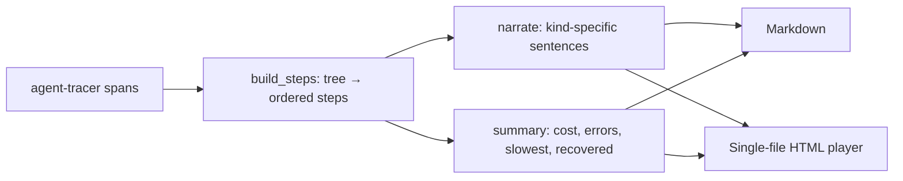

# Architecture — agent-replay

## 1. Scope
Turn agent traces into narrated walkthroughs that non-engineers can follow.
**MVP:** loads agent-tracer JSONL or a simple steps list, builds ordered steps with depth and
offsets, detects retries, narrates each step, summarises (TL;DR, slowest, priciest, recovered),
and renders Markdown or a self-contained HTML player.
**Product:** browser screenshots per step, voice-over video export, redacted share links.

## 2. Pipeline

## 3. Design decisions
- **Consumes the tracer schema directly.** Zero glue between observability and storytelling.
- **Retry detection** = the same step name immediately after an error. That's simple and catches
  the most common agent pattern.
- **The HTML player is one file with no external assets.** It can be emailed, attached to a PR or
  archived. It supports light and dark themes, keyboard navigation and a progress bar.
- **Everything user-provided is HTML-escaped** (step names, attributes, errors), and the tests assert
  that a `<script>` step name is neutralised.

## 4. Production architecture
A render service (trace ID → Markdown, HTML or video), share links with redaction rules (strip
secrets, emails and PII patterns before rendering), and asset storage for step screenshots
captured by browser-agent instrumentation.

## 5. Risks
Narration quality for unusual tools, so tools can register custom narration templates. Sensitive
data in traces, so redaction runs by default on shared links.
